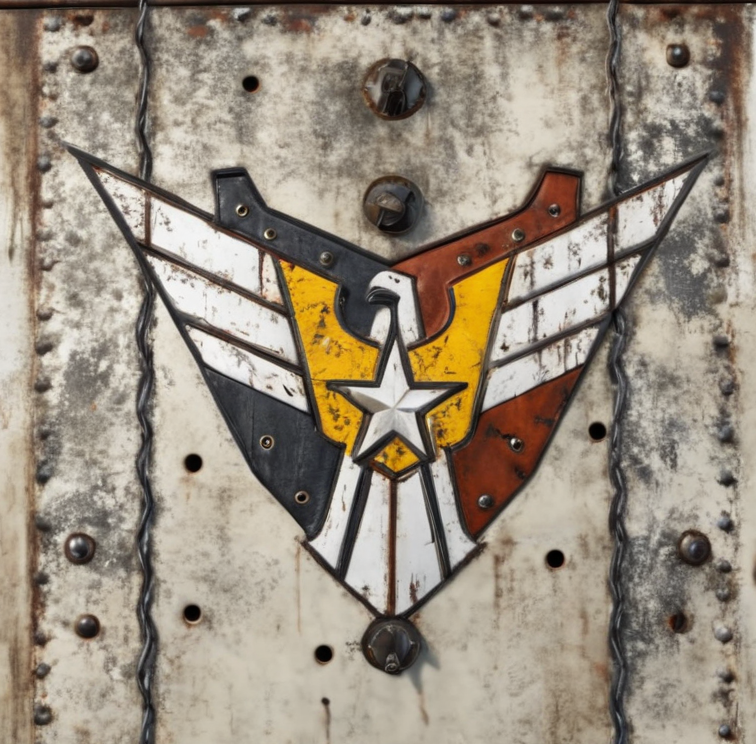

<p align="center">
  
</p>

<h1 align="center">General Refresh</h1>

<p align="center">
  <strong>A modernized <em>Command &amp; Conquer: Generals / Zero Hour</em> built on <a href="https://github.com/fbraz3/GeneralsX">GeneralsX</a> — native 64-bit, a Direct3D9 renderer with a PS 3.0 shader ceiling, AI-upscaled artwork, a modern command system, and truly smooth high-frame-rate gameplay.</strong>
</p>

<p align="center">
  <a href="https://github.com/Storm996/General-Refresh/releases"></a>
  <a href="https://github.com/fbraz3/GeneralsX"></a>
  
  
  
  
  
</p>

<p align="center">
  <strong>English</strong> · <a href="README.zh-CN.md">简体中文</a>
</p>

---

## 🧭 What is this?

**General Refresh** is a derivative of the excellent **[GeneralsX](https://github.com/fbraz3/GeneralsX)** project — a modern, open-source re-port of *Command & Conquer: Generals* and *Zero Hour*.

GeneralsX modernized the **platform**: SDL3 windowing, DXVK/Vulkan rendering, OpenAL/MiniAudio sound, a 64-bit toolchain and cross-platform online play — so the game runs on today's systems. **General Refresh goes one step further: it modernizes the game itself.** We build on that foundation and push the actual player experience forward:

### 🎨 Visual quality

AI-refined textures, dot3 normal maps, per-pixel lighting and PBR roughness materials make the battlefield dramatically crisper and more tactile.

### 🕹️ Gameplay & experience

High-frame-rate battles, an RA3-style selection panel, a reworked mission UI, quick-launch of any mission, and 8 personality-style AI drivers.

### 🛠️ Platform & build

A Direct3D9 renderer with a PS 3.0 shader ceiling, a native 64-bit build, and a modern audio/video stack (MiniAudio / OpenAL + FFmpeg).

> *Note: like GeneralsX, this is an engine re-port and requires original game data from a legitimate copy of Command & Conquer: Generals / Zero Hour.*

---

## ✅ Shipped Features

The following are **already implemented and playable**:

### 🎨 Visual quality

- 🎨 **Texture repaints / upscaling** — unit and terrain artwork has been re-painted and upscaled through an AI-assisted texture pipeline, replacing blurry low-res retail textures with crisper, higher-detail maps.
- 🧱 **Normal-mapped (dot3) rendering** — a tangent-space dot3 normal-mapping path is wired into the W3D renderer, giving surfaces real per-pixel lighting depth. It can be toggled live from **Options → the "Normal Mapping" checkbox** without a restart.
- 💡 **Per-pixel lighting** — rigid battlefield meshes are lit per pixel instead of per vertex: each batch's own directional lights (up to 4) are re-evaluated against interpolated world-space geometric normals with Blinn-Phong specular, sharpening light/shadow transitions on tanks and buildings; the ambient floor ships at 0.5 for stronger contrast. Enabled by default (`GENERALSX_GEOMNORMAL=0` reverts to per-vertex).
- 🔩 **Physically-based material (PBR roughness) rendering** — a metallic-roughness PBR path is wired into the dot3 lighting pipeline: `GENERALSX_PBR=1` selects the rough-Blinn variant and `=2` the GGX variant; surfaces missing the `_rp` material map fall back to constant rough/metal values. Assets are produced by an AI texture-decomposition pipeline (CHORD) that splits diffuse art into basecolor / normal / roughness / metalness channels, packed into engine `_rp.tga` maps — verified on real hardware with `[PBR] variant compiled/installed/mounted` and replay-CRC-proven logic independence.

### 🕹️ Gameplay & experience

- 🏎️ **High-frame-rate gameplay** — the battle itself now runs smooth: unit locomotion, steering, turret aiming, weapon fire and animation are interpolated at the display refresh rate in Skirmish, Campaign and cinematic views — all as a presentation-layer improvement on top of the unchanged deterministic simulation, so online play, LAN and replays stay bit-for-bit faithful.
- 🖱️ **RA3-style unit selection panel** — when multiple units are selected, the bottom-left panel groups them by unit type with a live per-type count (e.g. *Overlord Tank x2*, *Battlemaster Tank x2*). Clicking one type icon selects every unit of that type at once, which makes commanding large mixed armies dramatically easier.
- 🧩 **Mission UI rework** — the mission briefing / selection interface has been redesigned.
- 🎬 **Quick-launch any mission** — pick **any mission directly from the main menu** and jump straight into it, without walking through the full campaign progression.
- 🤖 **AI personality-style drivers** — Skirmish AI now ships with 8 distinct personality styles on top of the difficulty layer (Offensive, Defensive, Support, Rush, Blitz, Horde, Fortress, Sneak) plus a neural-AI scaffold, selectable per AI slot. Brutal difficulty is also strengthened (halved team tempo, earlier rally windows), and a `GENERALX_AI_TRACE=1` trace channel records driver dispatch, team activation and fortification events for verification.

### 🛠️ Platform & build

- 🎇 **Direct3D9 renderer** — the `DX8Wrapper` core has been ported from Direct3D8 to the modern Direct3D9 (`IDirect3D9`/`IDirect3DDevice9`, loaded at runtime from `d3d9.dll`), lifting the shader ceiling from `ps_1_4` toward `ps_3_0` and paving the way for multi-light, HDR and bloom effects without touching fixed-pipeline behaviour or replay compatibility.
- 🖥️ **Native 64-bit build (Windows x64)** — the Windows client has been fully ported to a 64-bit toolchain, breaking the legacy 32-bit process's 2GB/4GB address-space ceiling and **truly using all available system RAM and physical VRAM** — no 32-bit D3D8 shims needed anymore: the Direct3D9 renderer runs on the native 64-bit runtime.
- 🔊 **Audio & video backend modernization** — shipped together with the 64-bit switch: audio moved fully from the 32-bit Miles engine to **MiniAudio / OpenAL (x64)**, and intro/cutscene video is decoded by **FFmpeg**, completing the 64-bit platform layer.

---

## 🔭 In Progress & Roadmap

What we are actively building and planning next:

1. 🌿 **World ecosystem systems** — enriching the environment with living systems, currently a **grass/foliage system** (in progress) and a planned **particle-effect upgrade** (smoke, dust, explosions, weather).
2. 🗺️ **Mission map support** — expanded handling for mission/custom maps.
3. 🎮 **Native Vulkan / D3D11 renderer backend** — the long-term goal beyond the current D3D9 pipeline.

---

## 📰 Changelog

Every update is tracked by date in **[CHANGELOG.md](CHANGELOG.md)** — see exactly what shipped on which day, from the initial import to the 64-bit build, D3D9, PS 3.0 and beyond.

---

## 🚀 Getting Started

### Download & Play
Ready-to-run builds are published on the releases page:

* 📦 **[Download General Refresh Releases](https://github.com/Storm996/General-Refresh/releases)**
* 📖 Installation and game-data setup guides are available in the upstream Wiki lineage: [GeneralsX Wiki](https://github.com/fbraz3/GeneralsX/wiki)

### 🛠️ Building from Source
General Refresh uses CMake presets (inherited from GeneralsX). Windows (MSVC) example:

```bash
cmake --preset win32
cmake --build build/win32-vcpkg --config Release --target z_generals
# Output: build/win32-vcpkg/GeneralsMD/Release/GeneralRefresh.exe
```

For full prerequisites and the cross-platform Linux / macOS pipelines that GeneralsX provides, see the [GeneralsX build guides](https://github.com/fbraz3/GeneralsX/wiki).

---

## 📜 Project Lineage & Credits

General Refresh stands on the shoulders of the RTS community and open-source pioneers:

* **[Westwood Studios & EA](https://www.ea.com/)** — for creating the Command & Conquer: Generals universe.
* **[TheSuperHackers](https://github.com/TheSuperHackers/GeneralsGameCode)** — foundational code modernization, stability fixes and upstream preservation.
* **[GeneralsX / fbraz3](https://github.com/fbraz3/GeneralsX)** — the cross-platform SDL3 + DXVK + OpenAL re-port that this project is directly forked from.
* **[Fighter19](https://github.com/Fighter19) & [feliwir](https://github.com/feliwir)** — early reference work pioneering SDL3, DXVK and OpenAL in Zero Hour.

---

## 📄 License

See the [LICENSE](./LICENSE.md) file for details (GPLv3).
*EA has not endorsed and does not support this product. Command & Conquer is a trademark of Electronic Arts Inc.*
